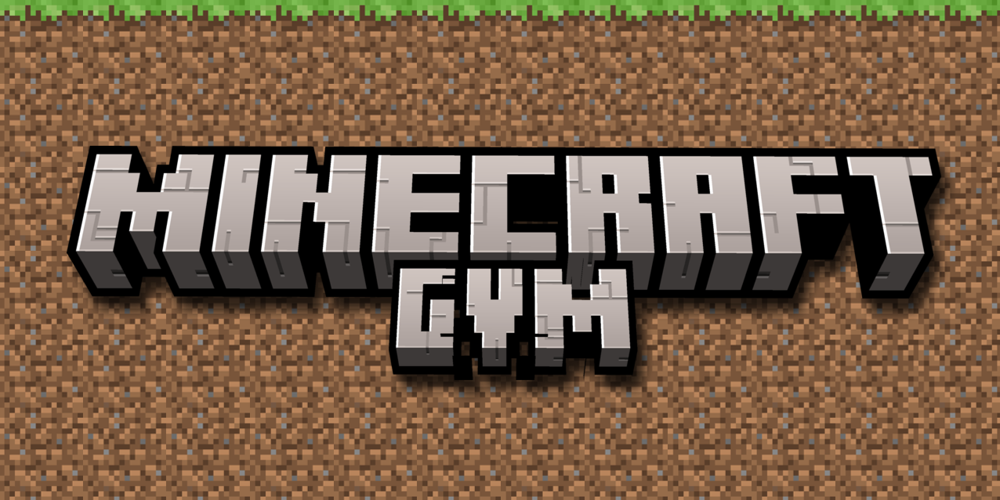

# Minecraft GVM

Uma viagem pela história do Minecraft, no mesmo mundo.

Você começa na Infdev de 17/06/2010 e avança pelas eras completando quests de exploração, construção e combate. Cada era termina com uma horda de zumbis. Depois de vencer, você escolhe quando avançar.

O mundo começa com 1000 × 1000 blocos e cresce 512 blocos por lado a cada avanço. Geração, recursos e mecânicas acompanham a época.

**Em desenvolvimento:** a base já tem quests e cercos até Adventure. O acesso ao End da 1.0 funciona; a sequência completa desse capítulo ainda está em validação. A jornada até a 26.3 é o objetivo do projeto.

## Jogar

Minecraft **26.3**, NeoForge **26.3.0.99** e Java **25**. Use uma campanha nova.

Baixe o JAR em [Actions](https://github.com/murasakll/MinecraftGVM/actions): abra uma compilação concluída e baixe **MinecraftGVM** em **Artifacts**. Extraia o ZIP e coloque o JAR na pasta `mods`.

## Compilar

Com Java 25 instalado:

```sh
./gradlew build
```

No Windows: `gradlew.bat build`. O mod fica em `build/libs/`; use o JAR sem `-slim` no nome.

Criado por Mura.